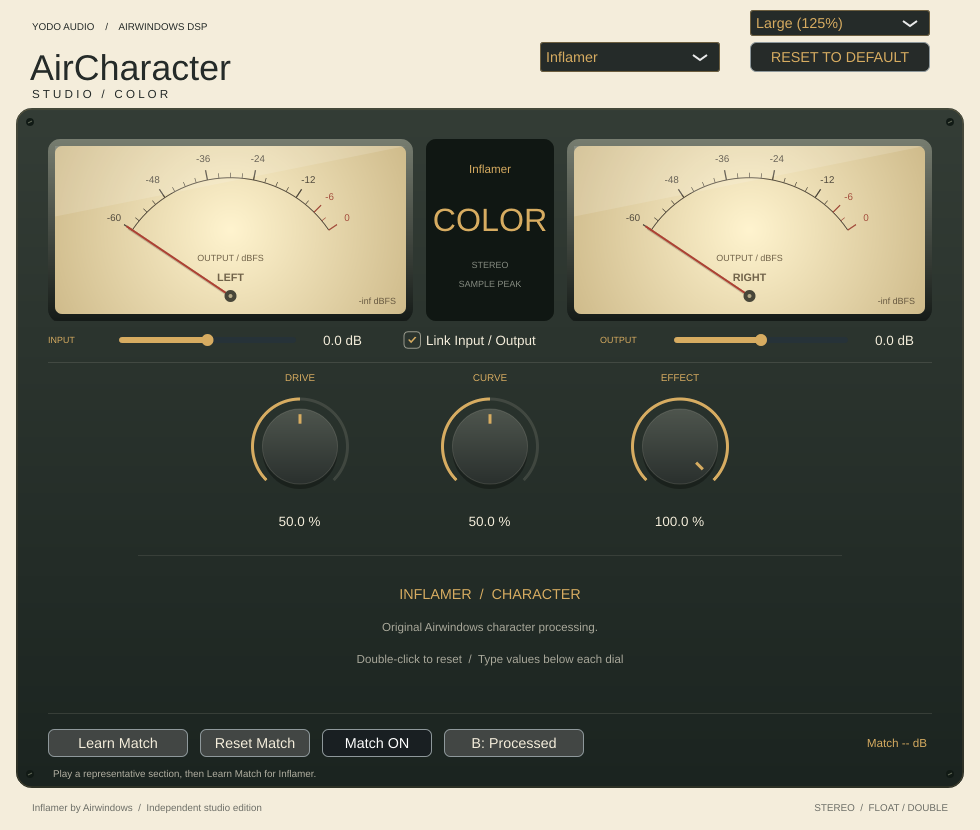

# AirCharacter Studio



A stereo VST3 with the same studio wrapper style, analogue output meters and
LUFS comparison workflow as ToTape Studio and AirEq Studio.

Twelve selectable original Airwindows processors:

| Model | Original controls | Defaults |
| --- | --- | --- |
| PurestWarm3 | Asym | 50% |
| Discontapeity | More | 0% |
| Sweeten | Sweeten | 0% |
| Inflamer | Drive, Curve, Effect | 50%, 50%, 100% |
| Coils2 | Saturate, Cheapness, Dry/Wet | 0%, 0%, 100% |
| Density3 | Density, Highpas, Output, Dry/Wet | 0%, 0%, 100%, 100% |
| Weave | Input, Smooth, Output | 10%, 50%, 100% |
| Longhand | Input, Output, Dry/Wet | 44.5%, 100%, 100% |
| PurestSaturation | Input, Output | 10%, 100% |
| Hypersoft | Input, Depth, Bright, Output | 50%, 50%, 50%, 50% |
| Creature | Drive, Depth, Inv/Wet | 26%, 26%, 100% |
| Tube2 | Input, Tube | 50%, 50% |

These are alternatives selected from the model menu, not a serial chain.
Each model remembers its controls, input/output trims, link setting, A/B setting,
and learned loudness adjustment. Control values retain Airwindows' normalized
mapping, displayed as percentages. Double-click a control to restore its default.
Small, medium and large interface sizes are saved with the session.

## DSP preservation

The original Airwindows source files are vendored unchanged. The standalone
engine processing bodies are byte-identical to their upstream float/double
bodies. Only the plugin interface, reset and parameter access are adapted;
dither seeds are fixed, as in the existing wrapper projects. Original dither,
antialiasing, nonlinearities and signal-dependent delays remain intact.

`python3 scripts/verify-dsp.py` checks source hashes and processing-body identity.
Reference tests compare samples exactly against separately compiled upstream
processors at 44.1, 48, 96 and 192 kHz, for both precisions, silence, variable
blocks, extremes and parameter changes. See [THIRD_PARTY.md](THIRD_PARTY.md).

## Level comparison

1. Play a representative passage and choose **Learn Match**.
2. Let it collect up to 15 seconds of audible audio, or finish after at least
   3 seconds using **Finish Learning**.
3. Toggle **A: Original / B: Processed** to compare. **Match ON/OFF** controls
   the learned compensation. **Reset Match** clears just that model's match.

Matching measures original input against processed output (including wrapper
trims) using gated stereo BS.1770 LUFS. It applies a fixed, smoothed gain after
the Airwindows processor, limited to ±24 dB; it does not continuously normalize
or change the DSP. Relearn after changing settings or material. Silent input
and insufficient learning time do not overwrite an existing successful match.
The original A/B path bypasses wrapper trims and matching. Output meters show
the left/right sample peaks of the audible path, including values above 0 dBFS.
No safety limiter is added.

Input and output trims span ±24 dB. **Link Input / Output** moves Output by the
opposite amount when Input is edited, within the output range. This is separate
from learned LUFS compensation.

## Mac M2 build and installation

Supported release target: native Apple Silicon arm64, macOS 11+, VST3.
Build and DAW validation on an actual Mac remain necessary; Linux tests do not
validate macOS signing or DAW scanning.

Install Xcode Command Line Tools (`xcode-select --install`) and CMake 3.22+
(`brew install cmake`), close your DAW, then run:

```bash
git clone https://github.com/johandoornenbal/aircharacter.git
cd aircharacter
bash scripts/build-sign-install-mac.sh
```

The script builds, tests, ad-hoc signs and installs to:
`~/Library/Audio/Plug-Ins/VST3/AirCharacter Studio.vst3`.
It stages and verifies the new bundle before replacing an existing installation,
and restores the previous bundle if replacement fails. Restart or rescan your DAW.

For a prebuilt bundle from the **Build Apple Silicon VST3** GitHub Actions
artifact, extract the outer artifact ZIP and the enclosed plugin ZIP first:

```bash
bash scripts/build-sign-install-mac.sh --install-only "/path/to/AirCharacter Studio.vst3"
```

`AIRCHARACTER_BUILD_DIR` and `AIRCHARACTER_INSTALL_DIR` override build/install
locations. JUCE 8.0.12 is pinned and fetched on first configure; pass
`-DJUCE_PATH=/path/to/JUCE` to use an existing checkout. Installation uses an
ad-hoc signature; the bundle is not Developer ID signed or notarized.

## Development checks

DSP and loudness tests without JUCE or GUI dependencies:

```bash
python3 scripts/verify-dsp.py
cmake -S . -B build-dsp -DAIRCHARACTER_DSP_ONLY=ON -DCMAKE_BUILD_TYPE=Release
cmake --build build-dsp --parallel 3
ctest --test-dir build-dsp --output-on-failure
```

Full VST3 build plus wrapper/UI and learning tests:

```bash
cmake -S . -B build -DCMAKE_BUILD_TYPE=Release
cmake --build build --parallel 3
ctest --test-dir build --output-on-failure
```

Full Linux builds require JUCE's development dependencies; they are development
checks only. Mac arm64 is the release target. Tests cover transparent wrapper
routing, model banks, trims/linking, UI sizes, meters, state recall and learned
gain application. Optional `AIRCHARACTER_PREVIEW_DIR=/absolute/path` saves each
model's UI snapshot when running `build/PluginChecks`.
